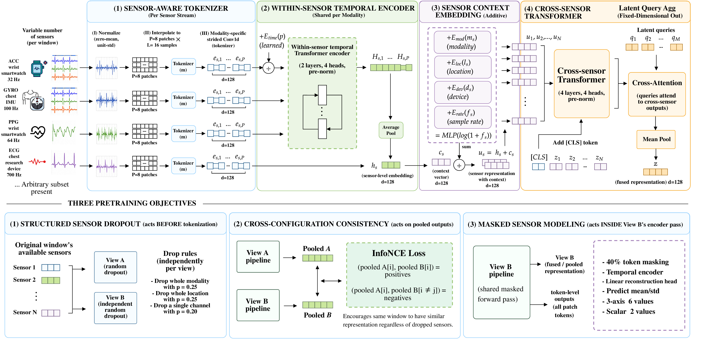

# HeteroWear

**Sensor-Aware Self-Supervised Learning for Heterogeneous Wearable Activity Recognition**

Yasaman Mohammadpour, Pouya Shaeri  
School of Computing and Augmented Intelligence, Arizona State University

HeteroWear pretrains one representation across eight wearable datasets that differ in sensors, body
locations, devices and sampling rates, and keeps it usable when the set of available sensors changes.
Within-sensor temporal modeling is separated from cross-sensor relational modeling, and a missing
sensor is **omitted** (padding mask), never imputed.

<p align="center">
  <a href="assets/architecture.pdf"></a>
</p>
<p align="center"><em>HeteroWear architecture (click for the vector PDF).</em></p>

## Architecture → code

| Paper | Code |
|---|---|
| Sensor-aware tokenizer (per-stream normalization, P=8 patches × L=16, modality-specific strided Conv1d) | [`src/models/tokenizer.py`](src/models/tokenizer.py) |
| Within-sensor temporal Transformer (shared per modality) | `TemporalEncoder` in [`src/models/heterowear.py`](src/models/heterowear.py) |
| Sensor context (modality, location, device, log-rate MLP) | `SensorContextEmbedding`, [`src/models/embeddings.py`](src/models/embeddings.py) |
| Cross-sensor Transformer with padding mask | `CrossSensorEncoder` |
| Latent cross-attention fusion (K=4 queries) | `LatentFusion` |
| Structured sensor dropout (p_mod=.25, p_loc=.25, p_ch=.20) | [`src/losses/structured_dropout.py`](src/losses/structured_dropout.py) |
| Cross-configuration consistency (symmetric InfoNCE, τ=0.1) | [`src/losses/consistency.py`](src/losses/consistency.py) |
| Per-axis masked sensor modeling (40% masking) | [`src/losses/masked_modeling.py`](src/losses/masked_modeling.py), targets in `tokenizer.py` |
| HW-Flat (original flat encoder, baseline) | [`src/models/hw_flat.py`](src/models/hw_flat.py) |
| Dataset adapters (8), windowing, splits, normalization | [`src/data/`](src/data/) |
| Baselines (RF, CNN, DeepConvLSTM, Transformer, Transformer-SSL) | [`src/models_baseline/`](src/models_baseline/) |

## Setup

```bash
conda env create -f environment.yml     # or: pip install -r requirements.txt
python -m unittest discover -s tests    # CPU smoke tests on synthetic data, ~2 s
```

## Data

Datasets are public and must be obtained by you under their own licenses:
PAMAP2, WISDM, HHAR, HARTH, UCI-HAR, PPG-DaLiA (fetched by `scripts/download/download_uci.sh`),
plus WESAD and MMASH (manual download). Place them under `data/raw/<dataset>/`.
`data/raw`, `data/processed`, `checkpoints/` and `logs/` are git-ignored; on a cluster, make them
symlinks into scratch storage. Subject splits and normalization statistics are in `data/splits/`.

## Pipeline

```bash
# 0. audit raw files (NaNs, timestamps, rates): run first on every new download
python scripts/preprocess/00_audit_raw_data.py --dataset all --data_root data/raw --limit_subjects 2
# 1. (HHAR only) split the large CSVs by user
python scripts/preprocess/01_split_hhar_by_user.py --hhar_dir data/raw/hhar
# 2. export raw windows, one pickle per subject  -> data/processed/<ds>/all/
python scripts/preprocess/04_export_raw_all_subjects.py --dataset pamap2 \
    --data_root data/raw --out_root data/processed --config configs/data/pamap2.yaml
```

Slurm jobs in [`jobs/`](jobs/) (set `HETEROWEAR_ROOT` / `HETEROWEAR_ENV`, adjust partition/account):

| Step | Job |
|---|---|
| Export windows | `export_all_raw.sbatch` |
| Supervised baselines | `run_baselines_v2.sbatch` |
| Leave-one-dataset-out pretraining (5 checkpoints) | `pretrain_heterowear_lodo.sbatch` |
| Joint pretraining on all 8 datasets | `pretrain_heterowear_joint.sbatch` |
| HW-Scratch vs HW-LODO, subject-disjoint LOSO | `finetune_heterowear.sbatch` |
| Held-out-device transfer (WISDM, HHAR) | `device_holdout.sbatch` |
| Missing-sensor robustness (identical masks for both models) | `robustness_curve_heterowear.sbatch` |
| Mechanism ablation on HHAR | `mechanism_ablation.sbatch` |
| Pretraining-seed stability | `seed_stability.sbatch` |
| Single-channel SSL control / fusion control | `pretrain_ts_transformer.sbatch`, `finetune_ts_transformer.sbatch`, `finetune_fusion.sbatch` |

Aggregate outputs into tables / figure:

```bash
python scripts/analysis/make_tables.py --out results/tables.md
python scripts/viz/plot_robustness_heterowear.py --out figures/robustness_heterowear.pdf
```

## License

Released under the [MIT License](LICENSE).
